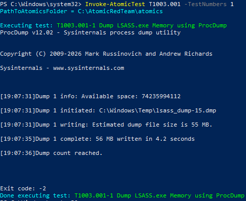
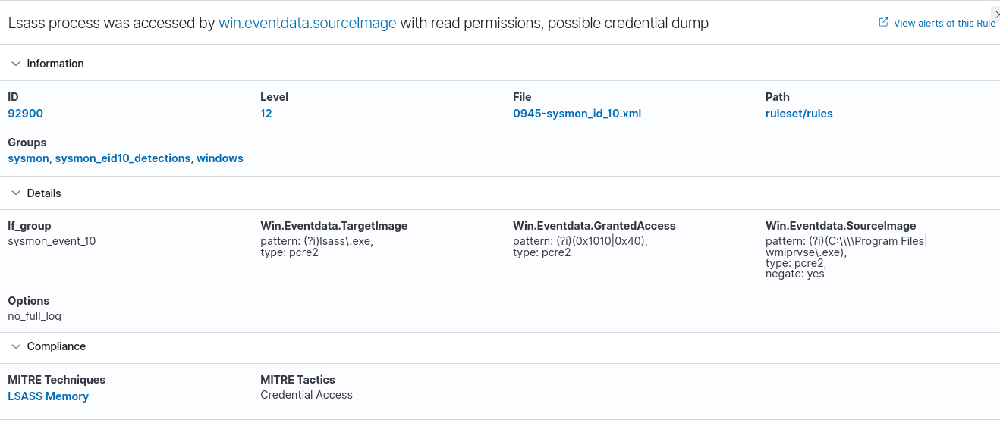
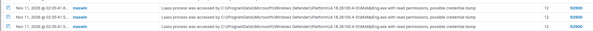
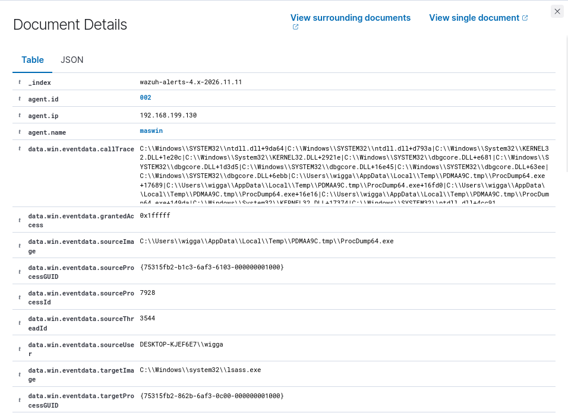
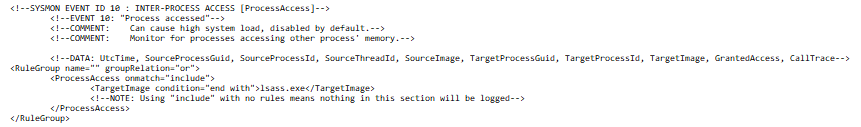
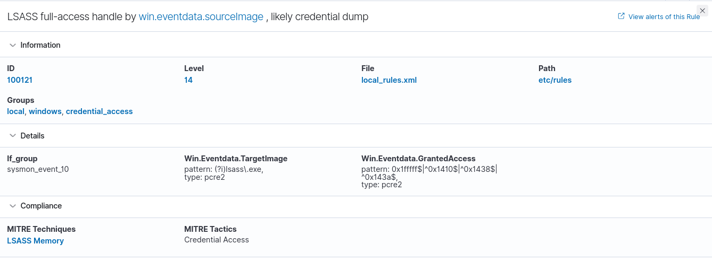
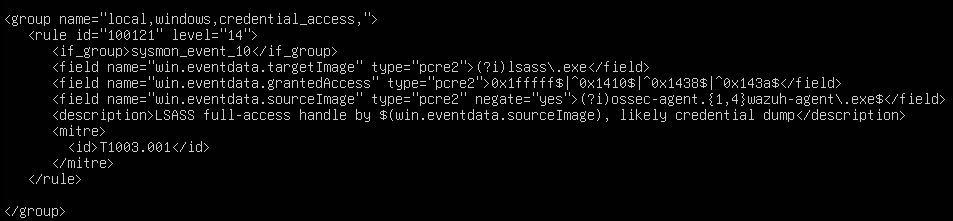
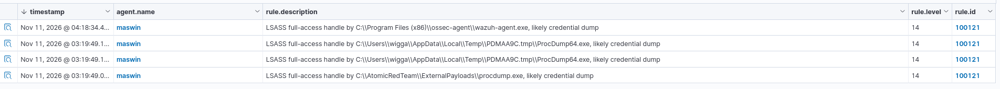
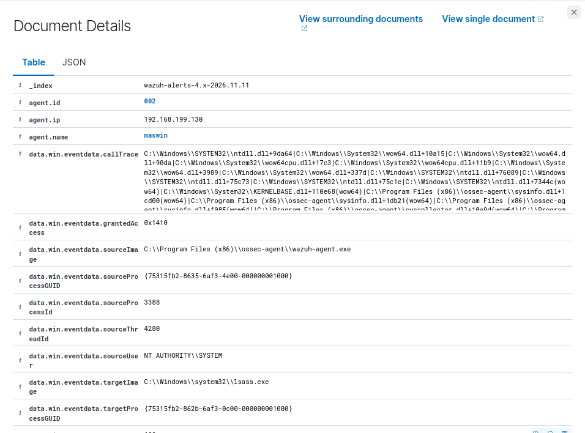
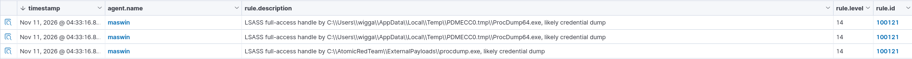

# Scenario 08: LSASS credential dumping (T1003.001)

**MITRE ATT&CK:** T1003.001, OS Credential Dumping: LSASS Memory
**Victim:** Windows agent `maswin` (Sysmon + Wazuh agent)
**Manager:** Wazuh 4.14.7
**Attack tool:** Atomic Red Team, test T1003.001-1 (ProcDump)

## What I did

I ran the Atomic Red Team ProcDump test on the Windows victim. It dumps the memory of `lsass.exe`, the process that holds logon credentials, to a file on disk. About 56 MB was written in 4 seconds (`01`).



## The detection gap

Wazuh ships a stock rule for this, **92900** (`0945-sysmon_id_10.xml`), level 12. It only matches Sysmon Event 10 when `GrantedAccess` is `0x1010` or `0x40` (`03`).



That is a read-only style of access. In my lab it fired on **Microsoft Defender** (`MsMpEng.exe`) doing its routine scan (`04`), which is noise. ProcDump asks for **`0x1FFFFF`**, full access to the process (`05`). The stock rule does not match that, so the real dump produced no LSASS alert at all.





## Problems I hit on the way

Sysmon logged nothing for Event 10 at first. The config had `<ProcessAccess onmatch="include">` with no rules inside it, and with `include` and an empty list nothing gets logged, even though the section looks enabled. I added a `TargetImage` rule for `lsass.exe` (`02`).



Defender blocked ProcDump with "Access is denied". I turned off real-time protection for the lab. In a real environment this is the first control that would stop the technique.

I also searched for the wrong process name. After self-extracting, the process touching LSASS is `ProcDump64.exe` in a temp folder, not `procdump.exe`.

My first custom rules never fired. I had chained them under the wrong parent, and Wazuh uses the first matching rule chain for an event, so a rule outside the stock Windows chain is never reached. The fix was to make the rule a child of the stock Event 10 group, `sysmon_event_10`, the same group the stock rules use.

## Custom rule

Rule **100121**, level 14, in `local_rules.xml` (`06`, `09`):

```xml
<group name="local,windows,credential_access,">
  <rule id="100121" level="14">
    <if_group>sysmon_event_10</if_group>
    <field name="win.eventdata.targetImage" type="pcre2">(?i)lsass\.exe</field>
    <field name="win.eventdata.grantedAccess" type="pcre2">^0x1fffff$|^0x1410$|^0x1438$|^0x143a$</field>
    <field name="win.eventdata.sourceImage" type="pcre2" negate="yes">(?i)ossec-agent.{1,4}wazuh-agent\.exe$</field>
    <description>LSASS full-access handle by $(win.eventdata.sourceImage), likely credential dump</description>
    <mitre>
      <id>T1003.001</id>
    </mitre>
  </rule>
</group>
```

It fires on LSASS access with full-access or credential-tool style access masks, and excludes the Wazuh agent itself.





## Tuning a false positive

The first version fired on `wazuh-agent.exe` with `GrantedAccess 0x1410` (`07`, `08`). That is the agent's own syscollector reading LSASS. The `0x1410` mask is in my list because public detection rules commonly list it for credential-dumping tools, so I kept it and excluded the agent by install path instead of dropping the mask. I matched the path, not just the filename, so a tool that merely renames itself `wazuh-agent.exe` is not excluded.





After the change, ProcDump still fires at level 14 (`10`).



## Result

| | Stock 92900 | Custom 100121 |
|---|---|---|
| Defender scan (`0x1010`) | Alert, level 12 (noise) | No alert |
| ProcDump full dump (`0x1FFFFF`) | **No alert** | **Alert, level 14** |
| Wazuh agent (`0x1410`) | No alert | No alert after tuning |

## What I took from this

- A rule that looks enabled can log nothing (Sysmon `include` with no rules).
- Stock detections have gaps. 92900 watches the wrong access mask for a real dump tool.
- Where a rule sits in the chain matters as much as what it matches.
- Every new detection needs a false-positive pass. My own monitoring agent triggered the first version.

## Limits

An attacker can use other access masks or other methods, such as `comsvcs.dll` MiniDump or direct syscalls. This rule covers the common tool-based path only. Defender real-time protection was off for the test.

## Next

Scenario 09: RDP brute force.
